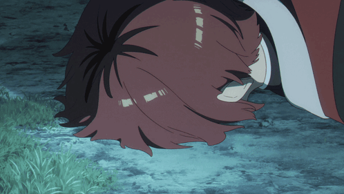

 

# Chiramy ♡

### Software Engineering Student | Aspiring Developer

*「A little progress every day adds up to big results.」*

---

## ♡ About Me

Hi! I'm **Emya**, a Software Engineering student at **Universiti Kebangsaan Malaysia (UKM)**.

I'm interested in software development, mobile applications, and game development. I enjoy turning ideas into functional projects while continuously exploring new technologies and improving my programming skills.

- 🎓 Software Engineering Student at UKM
- 📱 Interested in Android & Mobile Application Development
- 🎮 Exploring Game Development with Unity
- 💻 Learning through academic and personal projects
- 🌸 Always curious, always learning

## ✧ Tech Stack & Tools

## ✧ Tech Stack & Tools

**Programming Languages**

**Web Development**

**Development Tools**

**3D Modelling & Digital Design**

## ♡ Featured Projects

### 01. SuaraRasa — Android Mobile Application

A mobile application designed to support mental health and emotional well-being through features such as inspirational quotes, capsule letters, and a calming user experience.

- **Category:** Mobile Application Development
- **Language:** Kotlin
- **Platform:** Android

### 02. Jejak Warisan — Final Year Project

A non-immersive 3D virtual reality exploration game that brings Malaysian folklore and legends to life through an interactive map, traditional cultural artifacts, and trigger-based visual novel storytelling.

- **Category:** Final Year Project
- **Technologies:** Unity 6, C#, Blender, 3ds Max
- **Platform:** PC (Windows)

---

## ✧ GitHub Statistics

---

## ♡ Let's Connect!

I'm always open to learning opportunities, collaboration, and connecting with fellow developers.

- 💌 Email: [emeliasofea@gmail.com]
- 💼 LinkedIn: [emeliasofea](https://www.linkedin.com/in/emelia-sofea-56616727b/)
- 🐙 GitHub: [@emyaChan](https://github.com/emyaChan)

---

*Thanks for visiting my little corner of GitHub!* ♡

